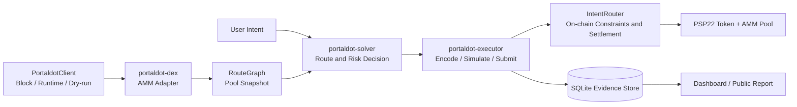

# Portaldot IntentFlow

Portaldot IntentFlow is an intent-driven DeFi execution system for Portaldot. Users submit only transaction constraints; an off-chain Solver selects a route from a fixed-block pool snapshot; the on-chain `IntentRouter` revalidates the constraints and settles the trade; and the full execution is stored as reviewable evidence.

> Current scope: the primary flow targets a single Portaldot network.

## Table of Contents

- [Problem](#problem)
- [Architecture](#architecture)
- [How It Works](#how-it-works)
- [Project Structure](#project-structure)
- [Quick Start](#quick-start)
- [Testing and Acceptance](#testing-and-acceptance)
- [Dashboard](#dashboard)
- [Security Boundaries](#security-boundaries)
- [Related Documentation](#related-documentation)
- [License](#license)

## Problem

A traditional swap flow requires the caller to select a pool, build calldata, and handle stale quotes, slippage, fees, and failed transactions. IntentFlow separates these responsibilities:

- Users declare the input asset, output asset, amount, minimum output, fee limit, and deadline block.
- The Solver compares one-hop and two-hop routes against the same pool snapshot and explains the associated risks.
- The Executor dry-runs the exact call that would be submitted before signing.
- The Router validates the route, allowlists, quote, deadline, replay status, and permissions on-chain.
- The EvidenceStore keeps the complete evidence from planning and simulation through the finalized receipt.

## Architecture



The system is organized into four layers:

| Layer | Main modules | Responsibility |
| --- | --- | --- |
| Domain and computation | `defi-domain`, `defi-engine` | Chain-neutral models, constant-product quotes, route search, risk scoring, and hashes |
| Chain adapters and orchestration | `portaldot-client`, `portaldot-dex`, `portaldot-solver`, `portaldot-executor` | Read chain state, select routes, encode Router calls, dry-run, and submit |
| On-chain contracts | `contracts/p2-interface`, PSP22, AMM, `intent-router` | Final constraints and settlement for assets, pools, and intents |
| Evidence and operations | `evidence-store`, `apps/dashboard`, `scripts/` | SQLite evidence, read-only queries, capability probes, acceptance reports, and deployment preflight |

Key design constraints:

1. The domain model and quote engine do not depend on RPC, ABI, or a database, so they can be replayed deterministically without a chain.
2. A route hash binds the network, block number, block hash, and route steps; an intent and route together produce a `commitment_hash`.
3. The Executor accepts only an accepted Solver decision and requires the dry-run and pending submission to have the same `call_hash`.
4. The Router does not accept arbitrary destinations, selectors, or calldata. It executes only interface-defined one-hop or two-hop routes.
5. The Dashboard reads persisted evidence only. It cannot sign, broadcast, or modify allowlists.

## How It Works

A single-chain execution follows these steps:

1. **Capability probe**: Read the TOML configuration and `PORTALDOT_TESTNET_WS_URL`, then check the runtime, metadata, Contracts pallet, dry-run API, and event query capabilities.
2. **Fixed snapshot**: Read AMM tokens, reserves, fees, and code hashes at one block and build a `RouteGraph`.
3. **Solver evaluation**: Enumerate one-hop and two-hop routes, calculate output, fees, price impact, snapshot age, and failure risk, then reject candidates that violate user constraints.
4. **Commitment generation**: Encode the intent, route, and call to produce `intent_hash`, `route_hash`, `commitment_hash`, and `call_hash` for later review.
5. **Dry-run**: Simulate the exact Router call at the route's starting block. A failure is stored as `Rejected` evidence and is never signed.
6. **Submission and confirmation**: Submit the same call after a successful simulation. The status becomes `Confirmed` only when the finalized receipt succeeds and contains the target Router's `RouteExecuted` event.
7. **Evidence storage**: Update SQLite through `Planned -> Simulated -> Confirmed/Rejected`, then expose the results through the Dashboard or public report.

The on-chain Router checks pause status, Solver authorization, intent replay, route age, deadline, token pairs, pool allowlists, minimum output, and fee limits again. Any failed token transfer, pool swap, or cross-contract call reverts the entire transaction.

## Project Structure

```text
.
├── crates/
│   ├── defi-domain/             # Domain models and execution evidence types
│   ├── defi-engine/             # Quotes, routes, optimization, risk, and hashes
│   ├── portaldot-config/        # TOML configuration and validation
│   ├── portaldot-client/        # Portaldot chain boundary and dry-run
│   ├── portaldot-dex/           # ink! AMM adapter
│   ├── portaldot-solver/        # Risk-aware route selection
│   ├── portaldot-executor/      # Router encoding and execution orchestration
│   └── evidence-store/           # In-memory / SQLite evidence storage
├── contracts/                   # Standalone ink! contract workspace
├── apps/dashboard/              # Local Dashboard and user intent entry point
├── config/                      # Testnet configuration
├── scripts/                     # Probe, deployment, acceptance, and report scripts
├── artifacts/                   # Generated acceptance reports and bundles
├── evidence/                    # Runtime evidence
└── docs/                        # Architecture and operations documentation
```

## Quick Start

### Requirements

- Rust 1.90, using the repository's `rust-toolchain.toml`;
- Node.js and npm;
- For contract tests, prepare the ink! / Wasm toolchain described in [`contracts/README.md`](contracts/README.md).

### Install and Run the Local Demo

```bash
git clone https://github.com/lijiaxin-jp/Portaldot-IntentFlow.git
cd Portaldot-IntentFlow
npm ci

# Check the Rust workspace
cargo check --workspace --locked

# Validate the default configuration (execution is disabled by default)
cargo run -p portaldot-config --example validate -- config/portaldot-testnet.toml

# Run the Solver demo without RPC, signing, or broadcasting
cargo run -p portaldot-solver --example route-demo
```

### Testnet Preflight and Acceptance (Optional)

The read-only capability probe requires a WebSocket endpoint:

```powershell
$env:PORTALDOT_TESTNET_WS_URL = "wss://<testnet-endpoint>"
npm run p8:probe
```

The deployment script performs a preflight by default. It does not read a mnemonic, sign, or broadcast:

```bash
npm run p2:deploy
```

Single-chain acceptance runs in dry-run mode by default. Broadcasting requires an explicit test account and all broadcast switches required by the script:

```bash
npm run p4:p8:acceptance -- --dry-run-only

# Before broadcasting, use a test account and set:
# PORTALDOT_TEST_ACCOUNT_ADDRESS
# PORTALDOT_TEST_ACCOUNT_MNEMONIC
# PORTALDOT_P3_BROADCAST=1
npm run p4:p8:acceptance -- --broadcast
```

The public report is generated from SQLite and existing deployment/probe evidence. It does not create on-chain evidence:

```bash
npm run p8:acceptance
```

## Testing and Acceptance

| Level | Command | What it proves |
| --- | --- | --- |
| Rust workspace | `cargo test --workspace --locked` | Off-chain domain models, quotes, routes, Solver, and storage logic |
| ink! contracts | `cargo test --manifest-path contracts/Cargo.toml --workspace --locked` | Token accounting, AMM mathematics, and Router policy helpers |
| Solver replay | `cargo run -p portaldot-solver --example route-demo` | Reproducible quotes, routes, risks, and hashes for fixed inputs |
| Capability probe | `npm run p8:probe` | Runtime, metadata, Contracts capabilities, and finalized block |
| Single-chain acceptance | `npm run p4:p8:acceptance -- --dry-run-only` | Pool snapshots, dry-runs, protection failures, and performance samples |
| Public report | `npm run p8:acceptance` | Deployment, transactions, events, runtime environment, and acceptance thresholds |

Local contract unit tests do not prove cross-contract rollback in the target runtime. That requires verification in the target contracts runtime or on a testnet. The public acceptance report reaches `ready_for_review` only when the deployment manifest, capability probe, successful finalized transactions, dry-run/submission performance samples, and reproducible runtime environment are all present.

## Dashboard

The Dashboard is a local operations view and user intent entry point:

```bash
npm run p7:dashboard
```

Open [http://127.0.0.1:8787](http://127.0.0.1:8787) by default. It reads `data/intentflow.sqlite3` and falls back to other SQLite evidence databases according to the project rules. Use `INTENTFLOW_EVIDENCE_DB` to select a database and `PORT` to change the port. The page provides a user intent form for the input asset, output asset, amount, minimum output, fee limit, deadline block, and maximum hop count; the backend reads the current pool snapshot and runs a dry-run before submitting only when the broadcast switch allows it.

The Dashboard API exposes `GET /api/intent/config` and `POST /api/intents`. Dry-run is the default. To allow broadcasting, set `INTENTFLOW_ALLOW_BROADCAST=1`, `PORTALDOT_TEST_ACCOUNT_ADDRESS`, and `PORTALDOT_TEST_ACCOUNT_MNEMONIC` in the Dashboard process; the browser never receives the mnemonic.

## Security Boundaries

- `config/portaldot-testnet.toml` defaults to `execution.enabled = false` and `dry_run_required = true`.
- Private key material is read only at the signing boundary through `PORTALDOT_SIGNER_URI` or the testnet mnemonic; it is not written to logs, SQLite payloads, or public reports.
- The Executor requires the simulated block, call encoding, and `call_hash` to match the submitted call.
- The Router performs final checks for permissions, allowlists, deadlines, slippage, fees, replay protection, and pause state.
- Public reports filter secrets, signing payloads, full RPC URLs, and database connection strings.

## Related Documentation

- [Architecture Design](docs/architecture-design.zh-CN.md)
- [Single-Chain Acceptance](docs/p4-p8-single-chain-acceptance.zh-CN.md)
- [P6-P8 Operations](docs/p6-p8-operations.zh-CN.md)
- [Inspection Readiness](docs/inspection-readiness.zh-CN.md)
- [Contract Workspace](contracts/README.md)
- [Dashboard Guide](apps/README.md)

## License

[MIT](LICENSE)
