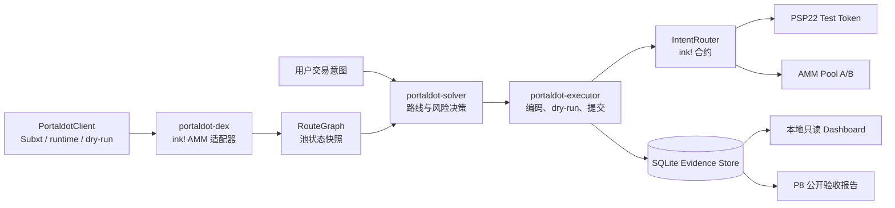
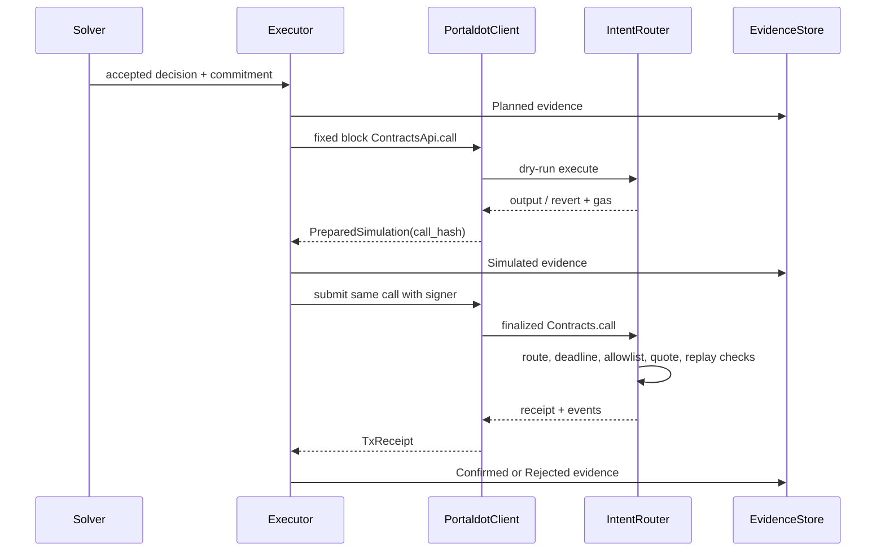

# Portaldot IntentFlow 架构设计

## 1. 文档目的

本文说明 Portaldot IntentFlow 的当前架构、模块职责、关键数据流、链上合约边界、执行安全门槛和证据链。文档以仓库中的 Rust workspace、独立 ink! 合约 workspace、Node.js 运维脚本、SQLite 证据库和只读 Dashboard 为依据。

项目的核心目标是：用户提交交易意图，链下 Solver 根据同一份池状态快照生成可复现的路线和风险评分，链上 IntentRouter 再验证路线约束并完成结算，最后把模拟、交易 receipt、事件和运行环境保存为可核验的证据。

当前主链路面向单个 Portaldot 网络。跨链类型和模拟器已经存在，但它们用于验证状态机和恢复路径，不能替代真实桥接协议、远端证明或跨链结算。

## 2. 架构结论

系统采用分层架构，链下负责发现、计算、预检、提交编排和证据持久化，链上负责最终约束校验和资产结算。



架构中的关键约束如下：

1. `defi-domain` 和 `defi-engine` 不依赖 Portaldot RPC、具体 ABI 或数据库，因此报价和路线选择可以在无链环境中确定性重放。
2. `portaldot-client` 只暴露业务级链适配器接口；Subxt、metadata、runtime API 和签名细节留在适配层。
3. `portaldot-dex` 通过已核验的 ink! metadata 读取 AMM 状态和事件，不接受任意合约 selector。
4. `portaldot-executor` 只构造固定的 IntentRouter `execute` 调用；提交必须经过同一请求、同一区块的成功 dry-run。
5. 合约失败以交易回滚和 finalized receipt 为准；Dashboard 和公开报告只读已持久化证据，不伪造当前链状态。

## 3. 代码组织

### 3.1 Rust workspace

根目录 `Cargo.toml` 将以下 crate 组织为一个 workspace，统一使用 Rust 2024、Rust 1.90 和 `unsafe_code = forbid`。

| Crate | 责任 | 主要输入 | 主要输出 |
| --- | --- | --- | --- |
| `crates/defi-domain` | 链无关领域模型和不变量 | 网络、资产、区块、池、意图 | `PoolSnapshot`、`SwapIntent`、`Route`、`ExecutionEvidence` |
| `crates/defi-engine` | 纯计算引擎 | 池快照、路线、输入金额 | 恒定乘积报价、候选路线、风险报价、hash |
| `crates/portaldot-config` | TOML 配置与环境变量校验 | `config/portaldot-testnet.toml` | 网络、合约、Solver、执行策略 |
| `crates/portaldot-client` | Portaldot 链边界 | WebSocket endpoint、metadata、runtime | 区块、能力报告、dry-run、receipt、事件 |
| `crates/portaldot-dex` | ink! AMM 适配器 | AMM contract bundle、链查询 | 池描述、池快照、报价、事件解码 |
| `crates/portaldot-solver` | 风险感知路线选择 | `RouteGraph`、`SwapIntent`、Solver policy | `SolverDecision`、候选解释、commitment hash |
| `crates/portaldot-executor` | Router 编码和执行编排 | Solver decision、metadata、执行策略 | `ContractCall`、模拟结果、交易 receipt、证据更新 |
| `crates/evidence-store` | 证据接口与持久化 | 意图、报价、模拟、receipt、事件 | 内存存储、SQLite normalized tables 和 JSON payload |
| `crates/cross-chain-simulator` | 跨链状态机模拟 | TOML fixture、scenario | simulation-only JSON/Markdown 结果 |

Rust 依赖方向保持单向：

```text
defi-domain
  ├── defi-engine
  ├── portaldot-config
  ├── portaldot-client
  └── portaldot-dex
          └── portaldot-solver
                    └── portaldot-executor
                              └── evidence-store
```

`portaldot-executor` 还依赖 `contracts/p2-interface`，用于复用链上 SCALE 类型、hash 规则和接口定义。链下 crate 不反向依赖 ink! 合约实现、Tokio runtime 之外的应用层或 Dashboard。

### 3.2 独立 ink! 合约 workspace

`contracts/Cargo.toml` 是独立 workspace。合约只依赖 `ink!`、SCALE/metadata 和必要的数学库，不依赖链下 crate、Subxt、SQLx 或网络客户端。

| 合约或 crate | 责任 |
| --- | --- |
| `contracts/p2-interface` | PSP22、AMM、Router trait；`SwapIntent`、`RouteStep`、`ExecutionResult`；路线、意图和 commitment hash |
| `contracts/psp22-test-token` | 测试专用 PSP22，管理员铸币，余额和 allowance，Transfer/Approval 事件 |
| `contracts/amm-pool` | 恒定乘积池，流动性份额，exact-input swap，滑点和 deadline 校验，池事件 |
| `contracts/intent-router` | Solver 授权、池白名单、暂停、重放保护、路线校验、跨合约结算和 Router 事件 |
| `contracts/p0-probe` | P0 合约生命周期探测，不属于交易业务链路 |

合约 bundle 中的 selector、event signature topic、code hash 和 metadata hash 是链下适配器信任边界的一部分。Executor 和 DEX adapter 在启动或构造时从已核验 bundle 读取这些值，避免手写 ABI 常量漂移。

## 4. 领域模型与数据契约

### 4.1 链无关领域模型

`defi-domain` 使用固定宽度和整数类型表达业务对象：

- `AccountId`、`ContractId` 和 `Hash` 均为 32 字节；
- `Balance` 为 `u128`，金额计算不使用浮点数；
- `NetworkId`、`BlockRef`、`AssetId` 描述网络和链上定位；
- `PoolSnapshot` 保存池地址、两个资产、储备、手续费、观察区块和可选 code hash；
- `SwapIntent` 保存用户约束：输入资产、输出资产、输入数量、最低输出、最大费用和 deadline；
- `Route` 保存网络、起始区块、路线步骤和 `route_hash`；
- `ExecutionEvidence` 保存从计划到 finalized/rejected 的状态和各类证据 hash。

模型在边界处主动拒绝零地址、零 hash、零流动性、非法费率、空路线、断开路线和过期/未来快照。这样 Solver、Executor、Store 和合约接口能够共享相同的基础不变量，而不依赖某一条链的地址字符串格式。

### 4.2 Hash 与可重放性

系统使用带版本前缀的 SHA-256 输入域，避免不同对象之间发生语义混淆：

| Hash | 绑定内容 | 用途 |
| --- | --- | --- |
| `intent_hash` | intent id、owner、资产、数量、最低输出、费用、deadline | 标识用户原始约束 |
| `route_hash` | 网络、区块号、区块 hash、路线步骤 | 绑定路线和池快照版本 |
| `commitment_hash` | `intent_hash + route_hash` | 防止 Solver 更换意图或路线 |
| `call_hash` | origin、Router、区块、selector、SCALE input、value | 保证 dry-run 与提交调用完全一致 |
| `simulation_hash` / `receipt_hash` | 结构化模拟或 receipt JSON | 证据去重和复核 |
| `event_hash` | finalized receipt 的事件集合 | 关联链上事件原文 |

链下 `defi-engine` 与链上 `p2-interface` 对路线、意图、commitment 的编码规则保持一致，并通过共享 golden vector 防止实现分叉。

## 5. 核心运行链路

### 5.1 启动和能力探测

1. `portaldot-config` 读取 TOML，校验 network、contract addresses、Solver 限制和执行开关。
2. `PORTALDOT_TESTNET_WS_URL` 只通过配置指定的环境变量读取，必须是 `ws://` 或 `wss://`。
3. `PortaldotClient` 连接 Portaldot，读取最新区块、runtime version、metadata hash 和账户余额。
4. 能力探测确认 `Contracts` pallet、`ContractsApi.call`、上传/实例化调用和事件查询都存在。
5. 探测结果写入脱敏 JSON；公开结果只保留节点 host，不保存完整 RPC URL、签名载荷或密钥。

能力报告由 `RuntimeInfo`、`ContractCapabilities` 和 `CapabilityReport` 组成。只有 `ink_ready()` 为真时，部署和 Router 执行链路才具备前置条件。

### 5.2 池状态发现

`InkAmmPoolAdapter` 依赖 AMM `.contract` bundle，解析 `token_0`、`token_1`、`fee_bps`、`reserves` 和 `quote_exact_input` selector。它通过 `ChainAdapter::dry_run_at` 在固定区块读取合约状态，并验证：

- token 地址按 canonical order 排列；
- 返回值没有 trailing SCALE bytes；
- 储备、费率和 code hash 符合 `PoolSnapshot` 不变量；
- 事件 topic 能映射到 `LiquidityAdded`、`LiquidityRemoved` 或 `Swap`。

多个池快照被组合为 `RouteGraph`。图的区块 hash 是所有候选路线的共同时间锚点，池快照不能来自未来区块，也不能在同一区块号使用不同 block hash。

### 5.3 Solver 决策

`portaldot-solver::evaluate` 在一份不可变 `RouteGraph` 上：

1. 枚举一跳和两跳路线；
2. 对每条路线计算 exact-input 恒定乘积报价；
3. 计算不含费的输出、含费输出、费损、曲线价格冲击和快照陈旧区块数；
4. 依次检查最低输出、用户最大费用、价格冲击上限、快照新鲜度和失败风险上限；
5. 用风险调整 score 选择最高候选，分数相同时按 `route_hash` 稳定排序；
6. 输出所有候选的接受/拒绝原因，生成 `SolverReport` 和 `report_hash`。

风险分数的结构为：

```text
score = expected_output
      - fee_cost
      - gas_cost_output_units
      - price_impact_penalty
      - stale_state_penalty
      - failure_risk_penalty
```

默认配置允许最多两跳，价格冲击上限 100 bps，快照最多陈旧 2 个区块，失败风险上限 500 bps。配置和报告会保留具体阈值，使同一输入可以被第三方重算。

### 5.4 Executor dry-run 和提交

`ExecutionRequest::from_solver_decision` 只接受已接受的 Solver decision，并把风险字段编码为 `QuoteEvidence`。`InkIntentRouterEncoder` 从 Router bundle 中获取 `execute` selector 和 `RouteExecuted` topic，然后使用共享合约类型进行 SCALE 编码。

执行顺序如下：



提交的硬门槛：

- `execution.enabled` 必须开启；
- `dry_run_required` 不允许被关闭；
- signer account 必须等于 call origin 和 Solver；
- intent fee 不得超过 execution policy；
- 模拟必须成功；
- 模拟区块必须等于 route 起始区块；
- `call_hash` 必须与待提交调用相同；
- receipt 必须成功且包含目标 Router 的 `RouteExecuted` 事件，才标记为 `Confirmed`。

保护性失败场景使用单独的 `submit_expected_rejection`，只允许提交已通过 dry-run 证明会失败的相同调用，从而把回滚场景也记录为 finalized 证据。

## 6. 链上合约架构

### 6.1 PSP22 测试代币

测试代币提供余额、授权和 `transfer_from`，管理员可以铸币。合约通过 `test_only()` 明确标识测试用途。Router 和 AMM 不直接操作任意 token 方法，而是依赖 `p2-interface::Psp22` trait。

### 6.2 AMM Pool

AMM 使用恒定乘积模型，手续费以 bps 表示，报价采用 checked `U512` 中间值：

```text
amount_in_after_fee = amount_in * (10_000 - fee_bps) / 10_000
amount_out = reserve_out * amount_in_after_fee
              / (reserve_in * 10_000 + amount_in_after_fee)
```

池状态包括两种 token、两边储备、总流动性和 LP shares。添加流动性要求按当前比例提供；移除流动性按份额比例返还；swap 要求 `amount_out_min` 和 deadline，有重入锁，并在跨合约调用失败时回滚。

### 6.3 IntentRouter

Router 是链上最终约束执行点，存储以下状态：

- 管理员；
- 暂停标志；
- 允许的池白名单；
- 授权 Solver 白名单；
- 已执行 intent id，用于重放保护；
- `entered` 重入保护。

Router `execute` 的校验顺序包括：暂停、调用者授权、intent 是否已执行、路线年龄、deadline、意图金额和 owner、路线长度与连接性、池白名单、池 token 对、路线 hash、commitment、报价最低输出和费用上限。所有跨合约 token/池调用完成后才发出 `RouteExecuted`。

Router 不接受任意目标地址、任意 selector 或任意 calldata。它只接受接口定义中的 `SwapIntent`、`RouteStep`、快照区块和 commitment。

## 7. 证据与存储架构

### 7.1 EvidenceStore 抽象

`EvidenceStore` 定义 `put`、`update`、`get`、`list` 和 `update_status`。当前有两个实现：

- `InMemoryEvidenceStore`：用于纯 Rust 测试和本地演示；
- `SqliteEvidenceStore`：用于运行器、Dashboard 和公开验收报告。

SQLite 以 `portaldot_evidence.payload_json` 保存完整结构，同时写入便于查询的 normalized tables：

| 表 | 作用 |
| --- | --- |
| `portaldot_runs` | runtime、区块范围、代码 revision 和机器配置 |
| `portaldot_deployments` | 合约地址、Wasm code hash、metadata hash、部署 receipt |
| `portaldot_pools` | 池地址、资产、手续费、快照区块 |
| `portaldot_intents` | 用户意图及其路线绑定 |
| `portaldot_quotes` | 输出、费用、gas、score 和风险字段 |
| `portaldot_executions` | tx hash、block hash、状态、输出和 event hash |
| `portaldot_evidence` | 完整 JSON、输入/路线/模拟/receipt hash 和时间 |

每次执行都按 `Planned -> Simulated -> Confirmed/Rejected` 更新同一 intent 的证据。SQLite 写入使用事务，normalized records 与完整 payload 一致提交，避免 Dashboard 读到半条记录。

### 7.2 公开报告

`npm run p8:acceptance` 从 SQLite 和可选部署/探测报告生成 JSON、Markdown 和 bundle manifest。报告会保留地址、代码 hash、metadata hash、交易 hash、区块 hash、事件十六进制和失败原因，但会过滤：

- mnemonic、secret、seed、password、token、credential；
- 签名载荷；
- 完整 RPC URL；
- 数据库连接串。

验收状态只有在部署清单、只读能力探测、至少 10 笔成功 finalized 测试网交易、dry-run/提交性能样本和可复现运行环境全部满足后才为 `ready_for_review`。报告生成器只汇总真实记录，不创建链上证据。

## 8. Dashboard 架构

Dashboard 位于 `apps/dashboard`，是一个本地 Node.js HTTP server 和静态前端：

- 服务绑定 `127.0.0.1`，默认端口 `8787`；
- SQLite 以 `readOnly: true` 打开，并执行 `PRAGMA query_only = ON`；
- 只提供 `GET /api/health`、`GET /api/overview`、`GET /api/evidence` 和按 intent id 查询的详情接口；
- 静态资源只允许 `index.html`、`styles.css`、`app.js`；
- CSP 限制为同源脚本、样式和接口；
- 前端展示运行摘要、池快照、意图、报价、风险、交易 receipt、事件和失败原因；
- 页面没有签名、广播、修改白名单或写入证据库的能力。

这种边界使 Dashboard 适合作为现场运维和复核工具：它能展示证据，但不能成为资金控制面。

## 9. 配置和部署边界

默认 `config/portaldot-testnet.toml` 将执行关闭：

```toml
[execution]
enabled = false
dry_run_required = true
```

部署脚本 `scripts/deploy-p2-testnet.mjs` 默认执行只读预检，广播需要同时满足命令行开关、环境变量开关、账户地址和 mnemonic。脚本支持通过计划 hash、endpoint host、signer account hash 和 finalized receipt 做断点续跑；恢复时会核对 chain identity、代码 hash、constructor input 和既有合约状态。

Rust client 的 `EnvironmentSr25519Signer` 只在签名边界读取 `PORTALDOT_SIGNER_URI`，签名器不接触 RPC 连接和交易编排；签名材料不会进入日志、SQLite payload 或公开报告。

## 10. 失败模型和安全不变量

### 链下失败

- RPC 断线：`FinalizedBlockStream` 重连，并对跳过的 finalized 区块执行 backfill；
- runtime/metadata 不兼容：能力探测或 ABI bundle 校验失败，停止后续执行；
- 池快照过期或区块 hash 不一致：RouteGraph 校验失败；
- Solver 无可接受路线：保留候选拒绝原因，不进入 Executor；
- dry-run 失败：写入 Rejected 证据，不签名；
- 模拟与提交不一致：拒绝提交，返回 `SimulationMismatch`；
- receipt 成功但缺少 Router 目标事件：按失败处理并保留 receipt。

### 链上不变量

1. 只有 owner 或授权 Solver 可以执行 intent。
2. 每个 intent id 最多成功执行一次。
3. 路线只能为一跳或两跳，且步骤连接、池白名单和 token 对都有效。
4. 路线快照不能超过 Router 允许的最大年龄。
5. 最低输出、最大费用和 deadline 在链上再次校验。
6. token transfer、pool swap 或任意一步失败会导致整个调用 revert。
7. 暂停时禁止新执行。
8. 重入锁阻止 Router 和 AMM 的嵌套状态破坏。
9. `RouteExecuted` 只在最终结算完成后发出。

## 11. 跨链扩展边界

`defi-domain::cross_chain` 定义跨链意图、消息、状态、事件和转换规则；`cross-chain-simulator` 使用两个本地模拟链、确认深度、消息 outbox、nonce 去重、源链回滚、目标链失败、过期和补偿状态来生成确定性证据。

典型状态流为：

```text
Created
  -> Locked
  -> SourceFinalized
  -> MessageSent
  -> TargetAccepted
  -> TargetExecuted
  -> SettlementPending
  -> Settled
```

失败流包含 `MessageExpired -> RefundPending -> Refunded`、`TargetFailed -> CompensationPending -> RefundPending`、`SourceReverted` 和 nonce 冲突。模拟结果明确写入 `simulation_only = true`，因此它不能被解释为真实桥接、远端 finality 或跨链资产安全证明。真实跨链实现需要另行确定桥协议、证明格式、消息重放策略、资金锁定和补偿责任边界。

## 12. 运行与验收分层

| 层级 | 入口 | 证明内容 | 不证明的内容 |
| --- | --- | --- | --- |
| 纯计算 | `cargo run -p portaldot-solver --example route-demo` | 报价、路线、风险和 hash 可重放 | 不连接链、不签名、不广播 |
| 合约单测 | `cargo test --manifest-path contracts/Cargo.toml --workspace --locked` | token、池数学、Router policy helper | 不证明真实跨合约 runtime 回滚 |
| 能力探测 | `npm run p8:probe` | runtime、metadata、Contracts 能力、finalized 区块 | 不部署 P2 合约 |
| 部署预检 | `npm run p2:deploy` | Wasm、constructor、存储押金、费用和恢复计划 | 默认不广播 |
| 单链验收 | `npm run p4:p8:acceptance` | dry-run、成功/失败 receipt、池快照、性能 | 只读模式不产生真实交易 |
| 公开报告 | `npm run p8:acceptance` | 汇总部署、交易、事件和性能门槛 | 不创建链上证据 |
| 运维视图 | `npm run p7:dashboard` | 只读查询和证据关联 | 不签名、不提交、不改配置 |

最新公开验收 bundle 的设计门槛是：5 条部署记录、完整 Contracts 能力探测、至少 10 笔成功 finalized 交易、dry-run 与提交样本，以及带 runtime、区块范围和机器配置的运行记录。该门槛是验收报告生成器的判定规则，不应与单纯的代码编译或本地模拟混淆。

## 13. 当前状态与后续演进

当前架构已经覆盖单链 Portaldot 的部署、池初始化、Router 配置、Solver、dry-run、广播、receipt 入库、Dashboard 和公开验收报告。工程上仍应把以下内容作为持续关注项：

- ink! 合约跨合约回滚和真实 runtime 行为需要持续用测试网/合约 runtime 验证；
- 两跳路线必须以当前部署 Router 的真实资产对和事件证据为准，不能只依据链下报价；
- 真实跨链协议仍未接入，模拟器输出不能升级为生产承诺；
- 多 Solver 竞价、更多池类型、链下索引服务和生产密钥托管不属于当前单链边界；
- 任何放开广播的配置变更都必须同时更新运行证据、风险阈值和回滚预案。

演进方向应优先保持现有接口稳定：扩展新的链适配器或池适配器时复用 `ChainAdapter`/`PoolAdapter`；扩展路线策略时保持 `RouteGraph` 和 hash 版本；扩展存储时保留完整 JSON payload 与 normalized 查询表的双层结构；扩展跨链时将真实证明和资金状态放在独立协议适配层，不把模拟器直接升级为执行器。

## 14. 参考入口

- 项目总览：`README.md`
- 单链配置：`config/portaldot-testnet.toml`
- 领域模型：`crates/defi-domain/src/lib.rs`
- 报价与路线：`crates/defi-engine/src/quote.rs`、`route.rs`、`risk.rs`
- Solver：`crates/portaldot-solver/src/lib.rs`
- 链适配器：`crates/portaldot-client/src/lib.rs`、`rpc.rs`
- AMM 适配器：`crates/portaldot-dex/src/lib.rs`
- 执行器：`crates/portaldot-executor/src/lib.rs`
- 证据存储：`crates/evidence-store/src/lib.rs`
- 合约接口：`contracts/p2-interface/src/lib.rs`
- Router：`contracts/intent-router/src/lib.rs`
- AMM：`contracts/amm-pool/src/lib.rs`
- Dashboard：`apps/dashboard/server.mjs`、`apps/dashboard/public/`
- 跨链模拟：`crates/cross-chain-simulator/src/lib.rs`
- 单链验收边界：`docs/p4-p8-single-chain-acceptance.zh-CN.md`
- P6-P8 运维说明：`docs/p6-p8-operations.zh-CN.md`
